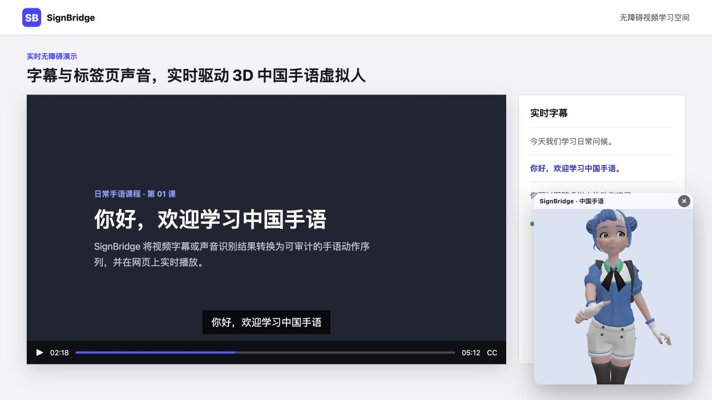
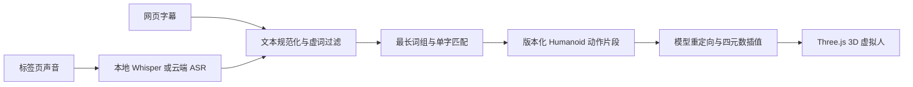

# SignBridge

**让网页视频多一种无障碍观看方式：读取字幕或识别视频声音，用 3D 虚拟人播放可检查、可扩展的中国手语动作。**

[](https://github.com/feifei9126/signbridge/actions/workflows/verify.yml)
[](LICENSE)
[](https://developer.chrome.com/docs/extensions/develop/migrate/what-is-mv3)
[](#工作原理与边界)
[](#两种声音识别方式)

SignBridge 是一个面向视频无障碍场景的开源 Chrome 扩展。我们希望为使用手语的聋人、听障用户提供一种补充观看方式，也让手语使用者、动作制作者和开发者能一起改进它。

项目不要求先替换视频网站：它读取网页可用字幕，或识别当前标签页的声音，再在浮窗中播放已有动作。动作数据由编辑器、录制工具和运行时共享，不需要每加一个词就重新猜测骨骼方向、手工复制多份参数。

> **当前定位：词典驱动的辅助原型，不是完整、准确的通用手语翻译器。** 自动化测试证明指定程序行为可运行，不证明手语含义正确。手语偏好和使用需求因人而异，本项目不替代字幕、专业翻译或人工沟通支持。



## 本地 T08 展示工作台（2026-10-12）

已增加独立 Demo 和实时字幕路由：14 段真实 T08 token 解码动作与 52 个内置动作共用当前 Godette 虚拟人。实时字幕完整匹配 14 条 T08 参考句时优先播放 T08 动作，其它文字仍走原有词库/自定义动作。独立 Demo 另支持文字最长匹配、未知内容提示、播放控制、三视角、实际 token 查看和来源报告下载。本地授权资产准备完成后，无需 GPU 即可演示。

已追加3条明确标记的候选重建：“如果下雨可以借你一把。”“我给她买了一件衣服”“去人民广场怎么走？”；它们用原T08权重编码/解码，未重训，镜像与人物分组仍待确认。Demo分别显示14条原参考句与3条候选，详细来源和限制见 [候选扩充记录](docs/t08-phrase-expansion-20261012.md)。

构建后双击 `signbridge/dist/start-demo.command`，或在插件弹窗点击“打开演示工作台”。完整覆盖清单、启动与复现方式见 [Demo 说明](docs/demo.md)。实时模式可播放14条T08原参考句，以及3条显式标记的T08编码/解码候选句；候选未更新权重且重建误差偏高。它不是任意文字到手语生成模型。

## 本次更新：六阶段优化

截至 **2026-09-22**，本次源码更新包含以下能力；扩展版本号仍为 `1.0.0`，本次同步不新建发行包或 GitHub Release。

| 阶段           | 已实现内容                                   | 对使用者的价值                     |
| -------------- | -------------------------------------------- | ---------------------------------- |
| 1 · 稳定性     | 输入排队、播放生命周期、停止采集与旧会话隔离 | 减少字幕切换和停止后的状态错乱     |
| 2 · 共享动作库 | 统一动作格式、草稿保存、预览与明确确认启用   | 制作工具和浮窗使用同一份动作数据   |
| 3 · 覆盖分析   | TXT / SRT / VTT 分析、缺词排序、制作入口     | 先知道缺什么，再决定补什么         |
| 4 · 动作包     | 整库导出、导入预检、冲突拦截、不覆盖已有记录 | 可以备份和协作，不直接信任导入动作 |
| 5 · 动作验收   | 批量回放、固定三视图截图、人工基准对照       | 修改前后有可比较的视觉证据         |
| 6 · 小批量补词 | 每批最多 8 个候选、状态跟踪、六轮回归验收    | 把缺词、制作、确认和复测连接起来   |

本轮本地验证：**133 项 Node 测试 + 63 项隔离浏览器检查通过**，构建、Lint 与格式检查通过。GitHub Actions 徽章只表示 CI 中的常规验证；真实网站、实际音频识别效果和手语语言质量仍需人工验收。

## 三步快速上手

### 1. 下载并构建

建议使用 Node.js 22 LTS；最低要求 Node.js 20.19，Chrome 116 或更高版本。

```bash
git clone https://github.com/feifei9126/signbridge.git
cd signbridge/signbridge
npm ci
npm run build
```

### 2. 加载扩展

打开 `chrome://extensions`，开启“开发者模式”，点击“加载已解压的扩展程序”。

**选择内层扩展项目生成的 `dist/`，不是仓库根目录。** 如果按上述命令克隆，完整层级为：`signbridge/signbridge/dist/`。源码和构建目录的区别如下：

```text
signbridge/                 ← Git 仓库根目录，README 在这里
├── README.md
├── docs/
└── signbridge/             ← 在这里运行 npm 命令
    ├── src/
    ├── tools/
    ├── tests/
    └── dist/               ← 在 Chrome 中加载这里
```

### 3. 开始翻译

打开包含视频的网页，点击 SignBridge 扩展图标并启动翻译：

- 先试手动输入 `你好` 或 `谢谢`，确认模型加载和已有动作播放正常。
- 已有可读取字幕：开启视频字幕，虚拟人会读取并播放已收录动作。
- 没有字幕：在“声音识别设置”中一键部署本地 Whisper，或配置云端 ASR，然后开启“视频声音”。

声音识别捕获的是**当前标签页音频，不是电脑麦克风**。字幕识别支持 TextTrack 和已适配的网页字幕节点；烧录在视频画面里的文字目前没有 OCR 支持。目标不限于 B 站，但不能保证所有网站都兼容。

已经安装过？在仓库根目录执行 `git pull --ff-only`，进入内层 `signbridge/` 执行 `npm ci && npm run build`，然后在扩展管理页重新加载扩展，刷新视频页并重新打开工具页。**如果本地有自己的代码修改，请先备份，不要强制覆盖。** 更新前也建议在动作工具中导出动作包；代码备份不包含浏览器里的自定义动作和视觉基准。

## 核心特性

- **字幕与视频声音双输入**：支持 TextTrack、常见网页字幕节点，以及 `tabCapture` 标签页音频。
- **隐私优先的本地识别**：Transformers.js + ONNX Runtime Web 在浏览器内运行 Whisper，模型首次下载后缓存复用。
- **可替换的云端 ASR**：支持 OpenAI-compatible 音频转写端点，密钥仅保存在 `chrome.storage.local`。
- **真实 3D 手语覆盖层**：Three.js + glTF 虚拟人，可拖动浮窗、旋转模型、上下平移和滚轮缩放。
- **共享、可备份的动作库**：姿势编辑器、关键帧录制器与浮窗共用动作数据。新动作先保存草稿，导入先预检；经预览和人工确认后才参与翻译。
- **按真实材料补词与验收**：分析缺词、维护最多 8 个候选的小批清单、回放动作、比较三视图，再重新测覆盖。不靠盲目扩大词条数掩盖质量问题。

## 两种声音识别方式

| 模式         | 数据位置           | 配置成本                 | 适用场景                   |
| ------------ | ------------------ | ------------------------ | -------------------------- |
| 本地 Whisper | 音频留在浏览器     | 首次一键下载模型         | 注重隐私、可离线复用       |
| 云端 ASR     | 音频发送到自选服务 | 填写端点、模型和 API Key | 追求更高识别精度或统一服务 |

本地模式默认建议从 `tiny` 开始。性能较好的设备可选择 `base` 或 `small`。模型会根据浏览器语言优先使用 Hugging Face 官方源或镜像，并在下载失败时自动回退。

本地部署仍需首次联网下载模型，并消耗本机算力；识别延迟与准确率取决于设备、模型、语言和音质。云端模式会把音频发送到你配置的服务，使用前请确认费用及隐私政策。不要公开 API Key，也不要把浏览器存储或含密钥的日志上传到 Issue。

## 如何增加动作，而不是反复调参数

1. **找缺口**：控制面板 →「词库覆盖分析」，粘贴实际字幕或导入 TXT / SRT / VTT。
2. **选小批**：从未覆盖词中点击「加入本批」，也可输入完整词组；每批最多 8 个，刷新后保留。
3. **制作草稿**：用清单里的「姿势编辑器」或「录制工具」预填名称和匹配文字，制作并保存自己的动作。
4. **人工验收**：在「动作验收」中找到该动作，回放并检查正面、侧面及手形、朝向、位置、节奏。确认含义和来源后，在原动作工具里预览并明确启用。
5. **重新测量**：清单随动作库变化更新；用同一份字幕重新分析，再到真实视频中试用。

「可完全匹配」仅表示文本可以匹配当前启用的数据，**不是手语正确性证书**。编辑已确认动作后需要重新确认。清单不会自动生成或启用动作，也不保存原始字幕；下载的进度 JSON 会包含所选词，请检查后再分享。

## 工作原理与边界



当前版本是**词典驱动的中国手语动画系统**，不是完整的通用 AI 手语翻译器。它按输入顺序播放已收录词条，未命中的词不随意选择替代动作；这不代表现有词条或整句意思已经通过专业手语审核。词典覆盖率、CSL 语法重排、非手控特征和动作质量仍决定最终效果，需要手语使用者参与验证。

当前内置 **52 个 SIGNS 条目、172 个查找别名、16 个 CHARS 回退**。172 是别名数，不是 172 个独立手语，也不是专业验收数量。本轮完善的是补词和验收工具，没有凭空新增声称正确的手语动作。

### 播放与停止行为

- 实时字幕和声音转写按段排队，不因下一段输入立刻打断当前动作序列；手动输入用于预览，会替换当前播放。
- 为避免长时间落后于视频，最多保留 2 段待播内容，等待超过 6 秒的内容不再播放；队满时丢弃最旧待播段。这是低延迟策略，不是无损的全文翻译。
- 关闭浮窗或停止翻译会停止本标签页的音频采集，并忽略旧会话迟到的转写；再次开启需要用户主动操作。
- 拖动视频进度条或视频清空时清除旧动作队列。未命中的文本不会打断正在播放的动作。

更详细的设计见[架构文档](docs/architecture.md)。

## 文档

- [架构与数据流](docs/architecture.md)
- [第一阶段稳定性修复与复测说明](docs/phase1-stability.md)
- [第二阶段共享动作库：制作、迁移与启用](docs/phase2-motion-library.md)
- [第三阶段词库覆盖分析：按真实语料补词](docs/phase3-coverage.md)
- [第四阶段动作库备份与安全批量导入](docs/phase4-motion-packs.md)
- [第五阶段动作可视化验收与截图回归](docs/phase5-motion-review.md)
- [第六阶段小批量补词、实际试用与发布验收](docs/phase6-acceptance.md)
- [手语视频的数据准备：清单、片段与关键点核验](docs/sign-language-dataset.md)
- [已核对视频的 SMPL-X 动作重建与 SOKE 数据接口](docs/sign-language-motion.md)
- [添加和调试手语动作](docs/gesture-authoring.md)
- [常见问题](docs/faq.md)
- [贡献指南](CONTRIBUTING.md)
- [安全策略](SECURITY.md)
- 构建后的控制面板提供“帮助文档”“姿势编辑器”“录制工具”“词库覆盖分析”和“动作验收”入口。覆盖分析支持粘贴文字及 UTF-8 TXT / SRT / VTT 导入，不上传分析材料；动作验收支持批量回放、固定三视图截图和人工基准对照，不自动判定手语正确性。

## 开发与验证

所有开发命令都在内层扩展目录执行：

```bash
cd signbridge
npm run dev       # 持续构建
npm run verify    # 构建 + ESLint + 自动化回归测试 + Prettier 检查
```

主要技术栈：Chrome Extension Manifest V3、Three.js、glTF、Transformers.js、ONNX Runtime Web、esbuild 和 Node.js Test Runner。

### 六轮浏览器回归

`npm run verify` 不包含浏览器测试。完整验收需要额外准备 Playwright 和支持扩展加载的 Chromium；它们不是当前项目的 npm 依赖。已有独立安装时，可在内层扩展目录指定路径：

```bash
export SIGNBRIDGE_PLAYWRIGHT_MODULE="/absolute/path/to/playwright/index.mjs"
export SIGNBRIDGE_CHROMIUM_PATH="/absolute/path/to/chromium-executable"
npm run verify:release
```

如果 Node 能直接导入 `playwright` 且对应浏览器已安装，可以不设置路径。脚本依次运行常规验证及 `tests/browser-phase1.mjs` 至 `tests/browser-phase6.mjs`，使用隔离浏览器数据，不读取日常 Chrome 个人资料。

- 验收报告：`signbridge/test-results/release-acceptance.json`，包含源码和构建 SHA-256、各阶段结果及人工待验收项。
- 页面截图和阶段报告：`signbridge/test-results/phase*-browser/`。
- 任一阶段失败则返回非零；测试期间源码或构建变化也会失败，不能拿旧报告证明新代码。
- `automatedStatus: "passed"` 仅代表本次自动化通过；`publishReady: false` 保留人工审批边界，不自动发布。

构建产物、依赖、测试报告、浏览器存储、私人导出素材和备份不作为源码提交。详细环境说明与人工验收表见[第六阶段文档](docs/phase6-acceptance.md)。

## 路线图

- [x] 多站点字幕捕获与标签页声音识别
- [x] 本地 Whisper 一键部署与云端 ASR 配置
- [x] Humanoid 动作空间、姿势编辑器和关键帧录制器
- [x] 句内多个已知词连续播放
- [x] 编辑器、录制器与浮窗共享动作格式及草稿确认流程
- [x] 真实语料覆盖分析、未覆盖词排序与动作制作入口
- [x] 已保存动作整库备份、批量导入预检与不覆盖保护
- [x] 动作批量回放、固定关键帧三视图截图与人工基准对比
- [x] 小批补词清单、共享库状态跟踪与六轮发布前自动验收
- [ ] 扩展至 200+ 经过人工验收的 CSL 词条
- [ ] CSL 语法重排与非手控特征
- [ ] glTF AnimationClip 动作资产导入
- [ ] 更广泛的过渡/穿模检测与跨模型重定向校验

## 参与贡献

欢迎提交经过验证的手语词条、模型适配、字幕站点适配、测试和文档改进。开始前请阅读[贡献指南](CONTRIBUTING.md)，并先运行：

```bash
cd signbridge
npm run verify
```

提交 Bug 时请附上网站、浏览器版本、复现步骤、控制台中以 `[SB]` 开头的日志，以及不含隐私内容的截图。动作贡献应说明 gloss、手形、位置、朝向、运动和验证依据。

不会编程也能参与：帮助判断动作含义、指出不同语境或地区的表达差异，提供经过授权的参考，或反馈哪个页面不方便操作。**目前最需要的是可验证的动作与真实使用反馈，而不仅是更多自动生成的词条。**

## License

[MIT](LICENSE) © SignBridge Contributors

MIT 适用于项目代码；第三方模型、纹理、依赖和外部素材仍须遵循各自许可证。请勿把代码开源理解为所有素材都可以任意再分发，提交或发布动作资产前需确认来源与授权。

## 黑客松演示网页

在线演示：<https://feifei9126.github.io/signbridge/>。展示页包含约一分钟的实际操作录屏、工作流程和已构建的 Chrome 扩展下载包，适合直接分享给评委。静态页面源码、更新方法见 [docs/README.md](docs/README.md)；网页供观看介绍与下载，实时手语功能需在 Chrome 中安装扩展。
